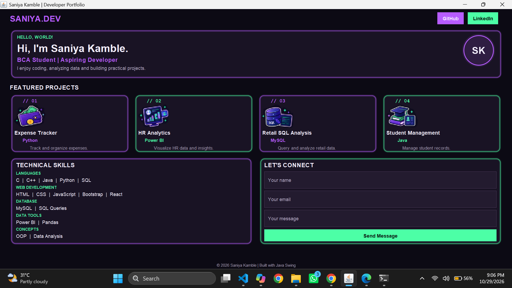
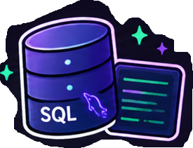

# Java-Swing-Portfolio
A modern personal portfolio desktop application built with Java Swing, featuring a custom dark theme, interactive sections, and creative visual elements.
## 📸 Project Screenshots

### 🖥️ Portfolio Application


### 💰 Expense Tracker


### 📊 HR Analytics Dashboard


### 🛒 Retail Management


### 🎓 Student Management System


---

## 🛠️ Tech Stack
- **Language:** Java
- **GUI:** Java Swing
- **Concepts:** Object-Oriented Programming (OOP)

## ✨ Features
- Modern dark-themed user interface
- Interactive portfolio sections
- Project showcase with visual elements
- Desktop application built using Java Swing

## 🚀 How to Run
1. Install the Java JDK.
2. Clone this repository.
3. Open the project in VS Code.
4. Compile and run `Portfolio.java`.

```bash
javac Portfolio.java
java Portfolio
```
